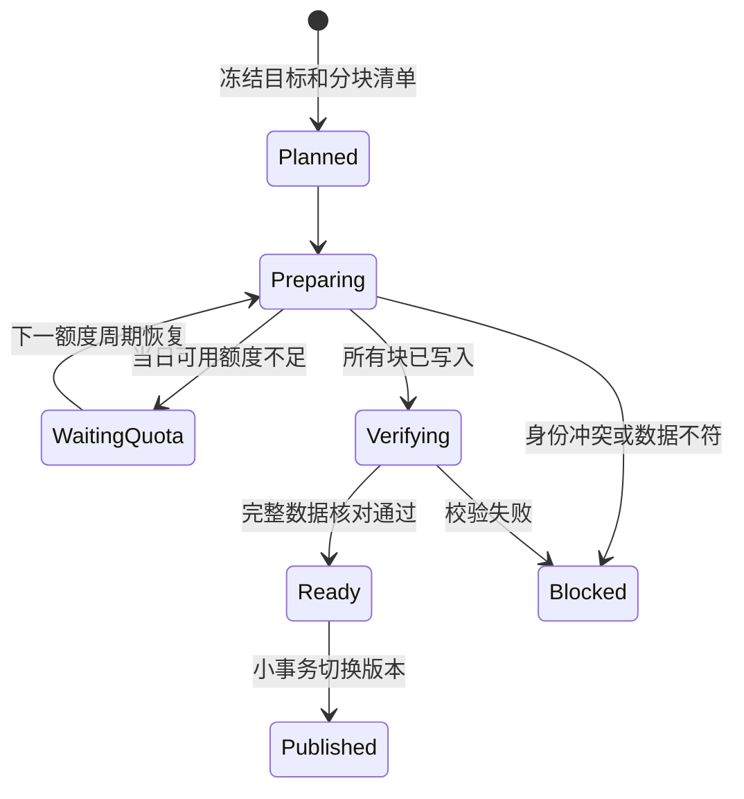

# 免费 D1 跨日更新设计

日期：2026-11-16。状态：设计稿；未修改发布程序，未启用线上工作流。

后续决策：该备选方案未实施，核心数据已改为[静态快照方案](static-snapshots.md)，洛谷继续使用 D1。下文保留用于理解跨日 D1 方案的取舍。

## 结论

采用“保留基础数据 + 不可变差异层 + 版本指针”。每天把一部分变更写入尚未公开的差异层，全部准备并验证完成后，只切换少量发布元数据。线上查询始终使用一个完整版本。

本次更新固定为已经归档的 `5ae94a62bf367fdc647612b5e6272152d702e1e9`，上游为 `fa92913a4d5fb8bfdad16cce6b647a3547241142`，基线为 `c61780492a9883aca7ce6e9ac5a65e77ccbfc9f6`。共有 100,172 行业务变更；旧流程估算 650,870 次写入。这个估算不能直接充当新结构的实际费用。

## 1. 为什么不能只把现有 publish 拆开

目前 publish 把核心表更新和版本记录放在同一事务里，保证失败时继续提供旧数据。把这个事务拆成几天直接更新，会使查询读到不完整的新旧组合。把 JSON 参数分段暂存，最后仍然集中修改核心表，也不能解决最终事务超过一天额度的问题。

完整 A/B 双份数据虽然容易查询，但首次需要复制当前数十万条未变化记录，并维护它们的索引，准备成本明显更高。因此本设计只新增有变化的记录，不首次重建全部核心表。

## 2. 数据和读取方式

- 原有 `OIer`、`Contest`、`School`、`Record` 成为固定基础版本，保留原索引；切换至新读取程序后，旧 publisher 禁止再修改这些表。
- 为四张表分别新增 Delta 表：保存 `layer_id`、业务键、完整新行，或删除标记。更新写完整新行，删除写标记，不提前删除基础行。
- 业务键沿用现有快照规则：OIer 为 uid；Contest/School 为 id；Record 为 `(oier_uid, contest_id)`，不能用重建时变化的 Record.id。
- `DataVersion` 保存冻结目标、基础身份、manifest、统计、schema/reader 协议版本和状态。
- `VersionLayer(version_id, layer_id, ordinal)` 明确列出一个版本包含哪些差异层。一个版本的行等于：基础行被列出的较新差异覆盖，再移除删除标记。
- `DataRelease` 增加当前 version_id，继续保存当前上游 SHA、快照身份等对外发布信息。

不能简单使用“layer 序号 <= 当前最大序号”：失败或回滚分支的数据可能因此被意外包含。查询只认该版本明确列出的层；回滚后生成的新版本也只继承回滚目标的层。

请求开始时固定 version_id、层列表和该版本统计；后续筛选、分块查询、内存核验、最终选手查询都使用同一版本。不能每条 SQL 都重新读取当前指针。`/version` 与响应中的数据版本也以这个身份为准。

当前 `query_oier.js` 把 contest_stats.json 编译进 Worker，需要改成按 version_id 读取、按不可变版本缓存的统计，避免部署新代码时提前采用未发布的数据统计。统计约 131 KB，应单独按参数绑定写入，不把整个 JSON 拼入 SQL 文本。

Delta 索引按实际查询入口建立：按业务键寻找覆盖记录、按比赛/奖项寻找记录、按学校/省份寻找记录，以及按选手属性筛选。不要机械复制全部旧索引。涉及历史层的最新行选择必须先确定可见性；不能先按用户条件过滤，再选较新行，否则旧值可能重新出现。

读取代价是本方案的主要风险。需要分别对基础表和差异层使用索引，并验证真实查询计划，不能每次先把四张完整可见表物化再筛选。新增的版本参数计入 D1 参数上限，原有分块大小必须相应调整。

## 3. 每天推进什么

1. 在本地或 Runner 完整生成、校验快照，冻结上游、生成规则、基线身份、目标 commit、schema 及确定性的分块清单。
2. 一次只准备一个发布目标；跨日继续已有目标，不每天改追上游 HEAD。期间发现的新上游只记录为下一候选，避免长期无法完成任何版本。
3. 先取得有到期时间和递增 fencing token 的发布锁。每个写事务检查 token，防止过期 Runner 继续写。恢复时以 D1 中的进度为准，而非 Runner 文件。
4. 每块直接写入 Delta 表；避免先存 JSON、最终再抄一次核心数据。块以 `(version_id, chunk_id)` 和内容摘要唯一标识。
5. 同一 D1 batch 中检查尚未完成、写入该块、记录块摘要/行数、推进游标及登记保守用量。块内容与完成标记一起提交或回滚。
6. 请求超时或响应丢失后先读块标记：相同摘要表示已完成，跳过；不存在才允许在重新检查额度和锁后尝试；摘要不同立即停止。不能用无条件 REPLACE 重写已完成块。
7. 块有固定的数据边界，大小先从少量行开始，通过实际执行耗时和 rows_written 调整。每条语句、参数数、单行大小和整个 batch 都必须符合平台限制；不能只凭“行数少”判断安全。

## 4. 额度调度

免费写入额度是账号级每天 100,000 行，北京时间 08:00 重置；索引维护也计写入。初始建议每天最多安排约 80,000 次同步相关写入，其余留给日常操作和误差。这个数是进度调度参数，不重新引入“变更太大就拒绝发布”的项目限制。

用量必须包括块标记、锁、索引、迁移、统计、失败请求的不确定消耗、验证元数据和后续清理。不能把 80,000 行业务变更当成 80,000 次写入。先做小规模实际计量，再重新估计整个任务天数；旧流程 650,870 / 80,000 向上取整为 9 个额度周期，仅是旧成本下的参考，不能承诺本方案 9 天完成。

`meta.rows_written` 用于校准实际成功操作，调用前按保守上界预留额度；返回后结算。丢失响应时保留用量预留，不能因为未收到成功响应就退回。账号分析指标用于核对其他写入，但不得假设它是零延迟的“剩余额度”接口。

网站洛谷 `sync=true` 也会写 D1，其他同账号数据库同样消耗额度。可控写入方需接入统一的预留/记账机制；不受本项目控制的其他应用无法仅靠本项目严格约束。无法核实可用额度时保持等待；明确的 quota 错误当日停止，不再重试。500 且块结果不明时先核对状态与用量，再决定是否重试。

同时给读取、存储和执行耗时留空间。免费读取也有限额；全量核验可以分天分页进行，已经封存的候选内容不可再变。若读额度不足，停在 Verifying，不能降级为只看行数就发布。迁移和清理安排在同一用量调度中。

## 5. 验证、发布和回滚

每块写完按确定键范围回读并在 Runner 计算规范化摘要，和冻结清单逐项比较。验证候选的完整可见状态、业务键唯一性、四表外键关系、行数、逻辑数据哈希及统计一致性；不把未完成的 Delta 原始表直接做整体外键检查。

封存后禁止修改该版本的层、层成员关系和统计。只有所有块已验证且候选基线仍匹配，版本才可转 Ready。若另一发布者改变基线，当前候选转 Blocked，不能强行套用旧差异。

最终 batch 只做少量元数据操作：验证锁和旧 version_id、确认 Ready、更新 DataRelease 指针与配套身份、记录激活结果。它不会再次执行十万行 INSERT/UPDATE/DELETE。发布响应丢失后查询 DataRelease：指向目标即已发布，仍指向旧版则未发布，未知时停止写入。

保留上一完整版本及依赖层，回滚也是小事务切回指针，并同时恢复版本统计和数据身份。查询请求固定旧版本时仍需可完成；清理旧层之前先让引用它的版本退役，并让过期请求明确重试整个查询，不能静默返回缺行结果。

若使用读副本，须在同一 D1 session 中固定读取路径和版本，候选验证及发布状态核对从主库开始。session 的顺序一致性不能代替本设计的不可变版本。

## 6. 层合并、空间与清理

层不能无限叠加。先以约 4 层作为触发离线合并评估的阈值，而非直接删历史。合并生成一层“相对于原基础数据的累计差异”，保留必要删除标记；可以跨日构建，并与旧层同时存在。验证结果相同后切换到等价新版本，再逐批清理无引用旧层。

清理 DELETE 及索引维护也消耗额度，不能在更新完成当天立即全量删除。首次迁移沿用基础表，避免复制全部未变记录；后续合并仍可能有显著写入成本，需要在每次计划中显示。

每次开始前估算基础表、全部保留层、新候选、索引和合并时双份层的峰值空间。免费单库上限 500 MB；接近上限则先清理安全可回收数据或等待维护，不能等写满再发现无空间生成替代层。

## 7. 落地顺序与验收

1. 新增版本目录、Delta 表、块进度和调度表；只加新结构，暂不导入全部基础数据。
2. 实现与旧基础版本兼容的统一读取层，并把统计改成版本绑定。所有 query_oier 路径和 Record 查询生成器必须覆盖。
3. 发布读取兼容版本，确认它读取当前基础版本与现网结果一致，再禁止旧核心发布器。
4. 以冻结的本次快照做本地完整重放，覆盖中断、跨日、响应丢失、并发、回滚及新分支。验证“准备一半仍完整显示旧版”和“激活后全部显示新版”。
5. 做有限的小批线上计量，校准写入/读取成本及索引计划，再给出预计完成日期。只在这些验收通过后恢复新的调度工作流；旧原子大事务入口保持禁用。

本轮已用内存 SQLite 样例检查 7 项读取语义：未公开层不可见、插入/更新/删除、最新层优先、旧版本仍可读、回滚后新分支排除被回滚层、过滤不会使旧值复活。它不等于真实数据性能或线上 D1 计量已经通过。

预计涉及 `incremental_sync.py`、新的跨日发布模块、迁移、`query_oier.js`、`record_query.js`、`version.js`、洛谷写入记账和工作流。先完成这些必要改造，再恢复发布；不能仅修改 cron 或给现有循环加 sleep。

## 官方依据

- [D1 定价与重置规则](https://developers.cloudflare.com/d1/platform/pricing/)
- [D1 大小、参数及执行限制](https://developers.cloudflare.com/d1/platform/limits/)
- [D1 batch 事务](https://developers.cloudflare.com/d1/worker-api/d1-database/)
- [操作返回的用量数据](https://developers.cloudflare.com/d1/worker-api/return-object/)
- [账号与数据库指标](https://developers.cloudflare.com/d1/observability/metrics-analytics/)
- [索引与查询计划](https://developers.cloudflare.com/d1/best-practices/use-indexes/)
- [读副本与 Sessions](https://developers.cloudflare.com/d1/best-practices/read-replication/)
